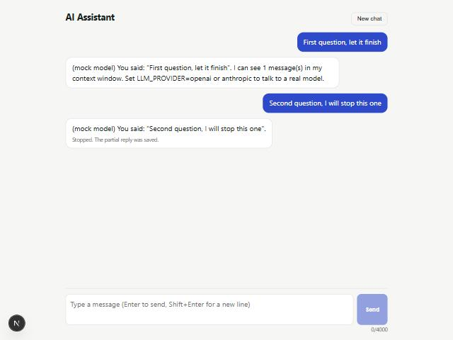

# AI chat module: NestJS + Next.js + PostgreSQL

A small, complete AI assistant module of the kind you add to an existing SaaS app: a NestJS API that talks to OpenAI or Claude, streams replies over Server-Sent Events, keeps the conversation in PostgreSQL, and fits long chats into the model's token limit without silently dropping anything. A Next.js chat UI streams the reply as it is written.



## The three places chat modules usually break, and what this one does

| Problem | What happens in many implementations | What this module does |
|---|---|---|
| **The user leaves mid-reply** | The model call keeps running (and costing money) after the tab is closed, or the half-written answer is lost | The API watches for the client disconnecting, aborts the model call, and saves the partial reply marked `stopped`. Covered by an end-to-end test |
| **Long conversations** | History is sent in full until the provider rejects it, or old messages are cut off silently | Every request gets a token budget: system prompt + running summary + the newest turns that fit, with room reserved for the reply. Turns that no longer fit are folded into the summary, never just dropped |
| **API keys** | Keys end up in the frontend bundle | Keys live only on the server. The browser talks to the NestJS API, never to the model provider |

Also included: request validation (`class-validator`), rate limiting (`@nestjs/throttler`), retry with exponential backoff on 429/5xx, a stop button, retry on error, and history restored on reload.

## Architecture

```
Next.js chat UI ──POST /conversations/:id/messages──▶ NestJS ChatController
   ▲   (reads the SSE stream with fetch,                  │ validates, opens SSE, aborts on disconnect
   │    stop = AbortController)                           ▼
   └──── event: token / done / error ◀────────── ChatService ── context budget + summary
                                                          │
                                      LlmProvider interface (one method to stream, one to complete)
                                      ├── OpenAiProvider    (LLM_PROVIDER=openai)
                                      ├── AnthropicProvider (LLM_PROVIDER=anthropic)
                                      └── MockProvider      (LLM_PROVIDER=mock, no key needed)
                                                          │
                                       TypeORM ── PostgreSQL (conversations, messages)
```

| Path | What it is |
|---|---|
| `api/src/llm/` | The provider interface, OpenAI / Anthropic / mock implementations, retry logic, and the module that picks one from config |
| `api/src/chat/context-budget.ts` | Pure function that decides which turns fit the budget (unit tested) |
| `api/src/chat/chat.service.ts` | Saves messages, builds the context, folds old turns into the summary, streams and persists the reply |
| `api/src/chat/chat.controller.ts` | REST + SSE endpoints, disconnect handling, heartbeat |
| `web/app/page.tsx` | Chat UI: streaming, stop, retry, error states, history restore |

### API

| Method | Path | Body | Returns |
|---|---|---|---|
| `POST` | `/conversations` | `{ "title"?: string }` | the new conversation |
| `GET` | `/conversations/:id/messages` | | message history |
| `POST` | `/conversations/:id/messages` | `{ "content": string }` (1 to 4,000 characters) | `text/event-stream`: `token`, then `done` (or `error`) |
| `GET` | `/health` | | `{ "status": "ok" }` |

## Run it

Requirements: Node.js 20+. PostgreSQL via Docker, or skip it with the in-memory option.

```bash
# 1. Database (or set DB_TYPE=memory in api/.env to skip this)
docker compose up -d

# 2. API on :3001
cd api
cp .env.example .env        # LLM_PROVIDER=mock works without any API key
npm install
npm run dev

# 3. Chat UI on :3000
cd ../web
cp .env.example .env.local
npm install
npm run dev
```

To use a real model, set `LLM_PROVIDER=openai` with `OPENAI_API_KEY`, or `LLM_PROVIDER=anthropic` with `ANTHROPIC_API_KEY`, in `api/.env`.

## Tests

```bash
cd api && npm test
```

11 tests: the context-budget rules (unit) and the HTTP API end to end on an in-memory database with the mock model: streaming and persistence, summarising instead of dropping old turns, a client disconnect that keeps the partial reply, validation errors and 404s.

## Notes for production

- Replace `synchronize: true` with TypeORM migrations.
- Add authentication and key the rate limit by user id instead of IP.
- Swap the character-based token estimate for the provider's tokenizer if you need exact counts.
- Put the SSE endpoint behind a proxy with buffering disabled (the API already sends `X-Accel-Buffering: no` and a heartbeat every 15 s).

## Licence

MIT. Built by Aqib Chattha as a reference implementation.
